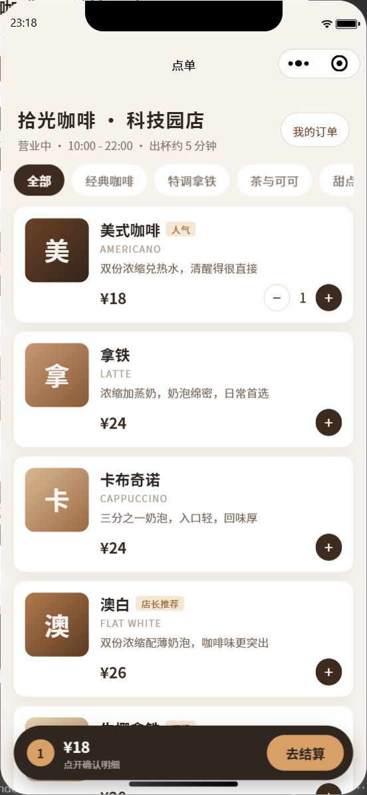
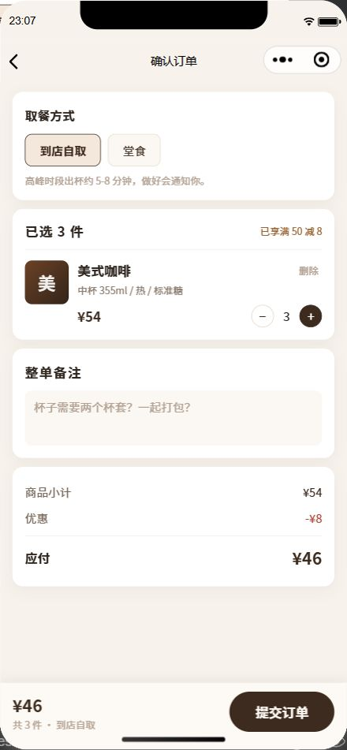
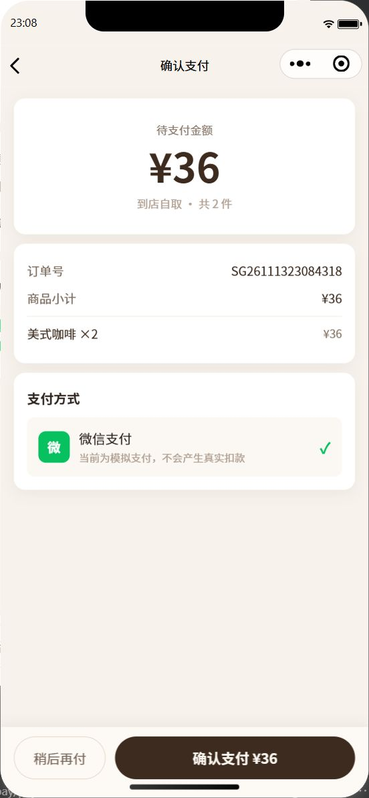
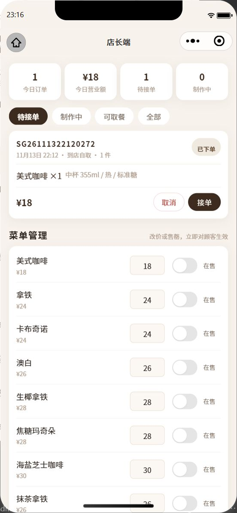

# 拾光咖啡 · 微信小程序点单系统

一个完整可运行的原生微信小程序点单 demo：顾客点单 → 提交订单 → 模拟支付 → 店长接单 → 制作 → 取餐。支持**本地单机**和**云端共享**两种运行模式，切换只改一行配置。

**默认是本地模式：不需要服务器、不需要云开发、不需要登录、不花一分钱**，数据存在本机 storage，克隆下来直接能跑。

### 两种运行模式

| 模式 | `dataSource` | 数据在哪 | 换台设备能看到订单吗 | 额外依赖 |
|---|---|---|---|---|
| 本地（默认） | `local` | 本机 storage | 不能，店长端是空的 | 无 |
| 云端 | `cloud` | WorkBuddy 托管 PostgreSQL | 能，两台设备同一份数据 | 需执行「构建 npm」 |

> **本地模式的边界**：顾客端和店长端读写的是同一台设备上的同一份 storage，所以「店长收到订单」只在这台设备内成立。
>
> 要真正跨设备收单，需要两样东西：一个中心存储，以及一个「有新单」的通知机制（轮询 / 订阅消息 / WebSocket）。云端模式把这两样都做了，实现说明与代价见 **[docs/cloud-backend.md](docs/cloud-backend.md)**。


<p align="center">
  
  
  
  
</p>

---

## 功能

**顾客端**

- 5 个分类、12 款商品的菜单，支持分类切换
- 商品详情：杯型（中杯/大杯 +3）、温度、糖度、加料多选（浓缩 +4 / 燕麦奶 +5 / 奶油顶 +6）、备注、实时算价、数量加减
- 购物车：同规格自动合并、增删改、删除二次确认、满 50 减 8
- 下单：堂食/自取、整单备注、优惠计算
- 模拟支付：待支付 → 支付成功才流转到「已下单」
- 订单：状态进度、再来一单、取消订单

**店长端**（订单页右上角进入，演示口令 `8888`；**只能看到本机的订单**，见上文边界说明）

- 经营看板：今日订单数、今日营业额、待接单、制作中
- 订单流转：接单 → 做好了 → 已完成，或取消订单
- 菜单管理：直接改价、一键设售罄（顾客端立刻生效）
- 演示工具：恢复默认菜单、清空订单

**关于页**：数据说明、隐私说明、本地存储键一览、一键清空

---

## 快速开始

1. 用**微信开发者工具**导入本目录（导入项目 → 选择本文件夹）
2. AppID 填自己的，或者点输入框旁的「测试号」自动申请（免费，个人可用）
3. 编译运行

> 仓库里的 `project.config.json` 带的是我本地测试号的 AppID，**请替换成你自己的**，否则你编译不了。

店长端口令默认 `8888`，在 `utils/app-config.js` 里可以改。

### 想试云端模式（跨设备收单）

1. `npm install`（装云 SDK）
2. 在 `utils/app-config.js` 里填上你自己的 `cloud.endpoint` 与 `cloud.publishableKey`（仓库里是占位符）
3. 开发者工具里点「工具 → 构建 npm」，生成 `miniprogram_npm/`
4. 把 `dataSource` 改成 `'cloud'`，重新编译
5. 真机调试时若请求被拦，检查 `endpoint` 是否已在 request 合法域名里，或勾选「不校验合法域名」

> **为什么留占位符**：这两个值会进小程序包、本身属于公开配置，但填了别人的，你的订单就写进别人的库。云端服务用 WorkBuddy 托管后端，在你自己的对话里开通一次即可，不花钱。

细节与代价见 [docs/cloud-backend.md](docs/cloud-backend.md)。

---

## 目录结构

```
├── app.js / app.json / app.wxss
├── pages
│   ├── index      点单首页：分类 + 商品 + 悬浮结算栏
│   ├── detail     商品详情：规格加料与算价
│   ├── cart       确认订单：数量、备注、优惠、提交
│   ├── pay        模拟支付：待支付 → 已下单
│   ├── orders     我的订单：状态进度、再来一单、店长端入口
│   ├── admin      店长端：看板、接单、改价、售罄
│   └── about      关于：数据与隐私说明
├── utils
│   ├── app-config.js   全局开关与门店参数（dataSource 决定数据放哪）
│   ├── menu-data.js    菜单种子数据（商品、规格、加料）
│   ├── menu-store.js   菜单读取 + 改价/上下架覆盖
│   ├── cart-store.js   购物车读写
│   ├── order-status.js 订单状态机（本地与云端共用同一套规则）
│   ├── order-store.js  订单的本地实现（storage）
│   ├── user-store.js   本地顾客身份（模拟 openid）
│   ├── cloud-client.js 云端 SDK 初始化
│   ├── workbuddy-cloud-diagnostics.js  官方请求诊断包装
│   ├── data
│   │   ├── index.js        按 dataSource 选实现，页面只依赖这里
│   │   ├── local-orders.js 本地实现的 Promise 包装
│   │   └── cloud-orders.js 云端实现（托管后端）
│   └── format.js       金额与时间格式化
├── scripts
│   ├── store-smoke-test.js   数据层冒烟测试（本地，18 项断言）
│   └── cloud-smoke-test.js   数据层冒烟测试（云端，直接打真实后端）
├── docs
│   ├── architecture.md      分层设计与数据流
│   ├── cloud-backend.md     云端模式的实际实现与代价
│   ├── cloud-migration.md   从本地迁移到自建后端的思路
│   └── launch-checklist.md  真正上线前的清单
└── screenshots
```

---

## 设计要点

### 数据层统一返回 `{ data, error }`

所有页面只调用 store 的方法，不直接碰 `wx.getStorageSync`：

```js
const result = cartStore.list();
if (result.error) { /* 处理异常 */ }
const lines = result.data;
```

好处是**换数据源时页面代码一行不改**。上云只需要把 `utils/*-store.js` 里的实现换成云端调用，保持方法名与返回结构不变即可，具体见 [docs/cloud-migration.md](docs/cloud-migration.md)。

### 订单状态机

```
unpaid（待支付）→ placed（已下单）→ making（制作中）→ ready（可取餐）→ done（已完成）
        ↓                ↓                 ↓
    cancelled        cancelled         cancelled
```

非法流转会被数据层拒绝（返回 `INVALID_TRANSITION`），页面不用自己判断能不能点。

### 菜单不写死在页面里

`menu-data.js` 是种子数据，店长的改价、售罄存在另一份 storage 覆盖表里，读取时合并。所以改菜单不需要改代码，也不会把整份菜单冗余写进存储。

### 数据源可切换

页面只调用 `utils/data/index.js` 暴露的接口。本地实现与云端实现的方法名、参数、返回结构完全一致（都返回 Promise 的 `{ data, error }`），所以切 `dataSource` 一行配置，页面代码一个字不用改。

代价是本地实现也被包成了 Promise——多一层，换来的是切换数据源时不用改业务逻辑。详见 [docs/cloud-backend.md](docs/cloud-backend.md)。

---

## 测试

数据层不依赖微信环境，可以直接用 Node 验证。

**本地模式**（18 项断言，覆盖顾客身份生成、菜单改价与售罄、购物车同规格合并、状态机流转、非法流转拒绝、今日统计、取消订单）：

```bash
node scripts/store-smoke-test.js
```

**云端模式**（10 项断言，直接打真实后端：写入 → 另一个客户端实例读回 → 接单 → 拒绝非法流转 → 统计 → 清理测试数据）：

```bash
npm install
node scripts/cloud-smoke-test.js
```

---

## 这个项目刻意**没有**做的事

| 未实现 | 原因 | 怎么补 |
|---|---|---|
| 真实微信支付 | 需要企业主体 + 商户号，个人开发者开不了 | 见 `pages/pay/pay.js` 里的注释块与 `docs/cloud-migration.md` |
| 登录 / 会员 | 本地模式不需要；云端模式也没做，所以数据没有按人隔离 | `utils/user-store.js` 留了替换点 |
| 后台审核权限 | 前端口令只能防误触，不是权限；云端订单表目前对所有人开放读写 | 服务端校验角色，见 `docs/cloud-backend.md` 第三节 |
| 菜单云端同步 | 目前订单上云了，菜单与购物车仍在本机 | 给 `menu-store.js` 套同一套适配层 |
| 状态流转的服务端原子性 | 云端实现是「读→校验→写」，并发下可能都通过 | 改成数据库函数 |
| 真实商品图片 | 避免依赖图床，用 CSS 渐变 + 单字代替 | 换 `<image>` 指向云存储或 CDN |

---

## 许可

MIT，仅作学习与演示用途，商品名称与价格均为虚构数据。
